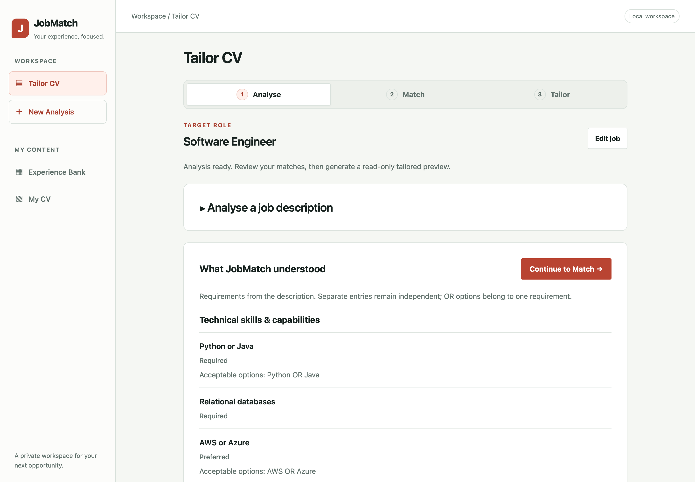
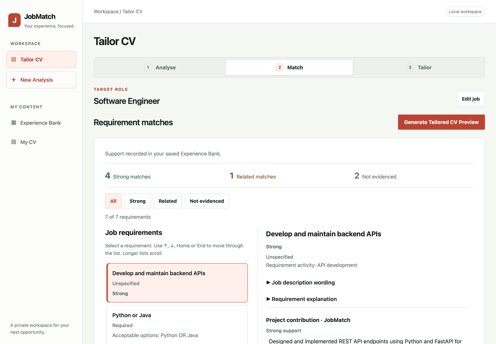
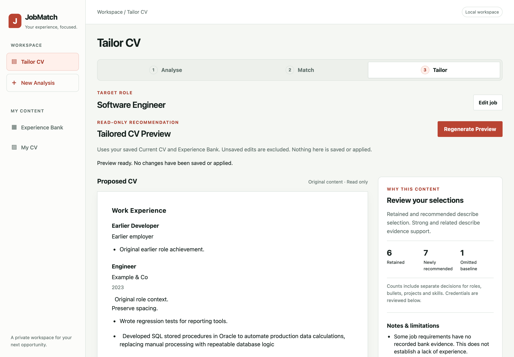

# JobMatch CV Tailor

JobMatch is a local CV tailoring application that analyses job descriptions,
matches requirements against a structured Experience Bank and recommends relevant
existing CV content. OpenAI extracts the requirements; deterministic Python
services match and select recorded evidence, preserving its original wording
rather than inventing qualifications or rewriting achievements.

## Key features

- **Structured job analysis:** source quotations, required/preferred importance
  and grouped alternatives such as Python OR Java.
- **Deterministic matching:** strong, related and missing classifications, with
  technical relationships and safeguards against overstating practical experience.
- **Experience Bank and My CV:** manage recorded experience and an ordered baseline
  CV, with explicit saves and configurable tailoring limits.
- **Evidence-based selection:** recommend relevant achievements, projects and
  explicitly recorded skills, with source references and explanations.
- **Read-only tailored preview:** review selections, omissions and requirement
  coverage without changing saved content.

## Tech stack

**Backend:** Python, FastAPI, Pydantic, OpenAI API (Python SDK) and Uvicorn.
**Frontend:** JavaScript, HTML and CSS. **Storage:** local JSON files.
**Testing and CI:** pytest, HTTPX, JavaScript behaviour harnesses and GitHub Actions.
No database or frontend build step is required.

## Screenshots

The local application shown with fictional data and controlled analysis responses.

| Analyse requirements | Match evidence | Review the tailored preview |
| --- | --- | --- |
|  |  |  |

## Run locally

Use Python 3.11 or newer and Git. From a terminal:

```bash
git clone https://github.com/jasminekan/CV-Tailor.git
cd CV-Tailor
python3 -m venv .venv
source .venv/bin/activate
python -m pip install -r requirements.txt
```

On Windows PowerShell, use `python` instead of `python3` and activate with
`.\.venv\Scripts\Activate.ps1` instead of `source`.

Copy `.env.example` to `.env` if you do not already have one. Set
`OPENAI_API_KEY=your-openai-api-key` in that local file to enable live job analysis.
Matching, preview selection and the editors do not need a key. Never commit a
configured `.env` or personal JSON stores.

| Variable | Default | Read from |
| --- | --- | --- |
| `OPENAI_API_KEY` | Required for `/analyse` | Process environment or `.env` |
| `OPENAI_MODEL` | `gpt-4o-mini` | Process environment or `.env` |
| `EXPERIENCE_BANK_PATH` | `data/experience_bank.json` | Process environment only |
| `CURRENT_CV_PATH` | `data/current_cv.json` | Process environment only |

Default stores live under the repository root and start empty when absent;
explicit saves create the files. Keep personal stores in ignored `data/` or outside
the checkout. Export custom paths before starting the server; putting them only
in `.env` does not configure them. Store paths and their `.tmp` save paths must
be distinct. A [fictional example bank](examples/experience_bank.example.json)
illustrates the data format.

Start the application from the repository root:

```bash
python -m uvicorn app.main:app --host 127.0.0.1 --port 8000
```

Open [JobMatch](http://127.0.0.1:8000/) or the
[interactive API documentation](http://127.0.0.1:8000/docs).
Press **Control-C** in Terminal to stop the server; use `--reload` only for development.

Add records in **Experience Bank** and choose your baseline roles and content in
**My CV**. Then use **Tailor CV → Analyse → Match → Tailor** to review a job and
generate recommendations. Navigation preserves drafts; saving is explicit.

### macOS launcher

After initial setup, double-click [JobMatch.command](JobMatch.command) in Finder.
It uses this checkout's `.venv`, waits for JobMatch on port 8000 and opens your
default browser. Keep its Terminal window open and press **Control-C** there to
stop it. Closing the browser does not stop the server; VS Code is not needed.

The launcher reuses an existing JobMatch instance without starting another server;
stop that instance in its original Terminal window. It leaves an unrecognised
service on port 8000 alone and uses the configuration rules above.

If executable permission is missing, run `chmod +x JobMatch.command` once from the
project folder. If macOS blocks a trusted copy, use **System Settings → Privacy &
Security → Open Anyway** after the blocked attempt; see
[Apple's opening guidance](https://support.apple.com/guide/mac-help/open-a-mac-app-from-an-unknown-developer-mh40616/mac).

## Testing

```bash
python -m pytest -q
```

Tests use fictional fixtures, temporary stores and mocked OpenAI responses;
no API key or live provider requests are needed. Coverage includes validation,
matching, provenance, selection, persistence and frontend state safeguards.
JavaScript tests require Node.js or JavaScriptCore (`jsc`); they skip if neither
is available. DOM/network mocks complement real-browser checks.

[GitHub Actions](.github/workflows/tests.yml) runs the full suite on pushes to
`main` and pull requests targeting `main`, using Ubuntu, Python 3.12 and Node 24.
It installs `requirements.txt`, uses temporary stores and no OpenAI credentials,
and points the provider URL at localhost. Results appear in **Actions** and PR
checks; the workflow does not deploy or publish the application.

The separate [extraction evaluation harness](evaluations/extraction/README.md)
compares prompts and models against authored expectations. Live runs are opt-in;
mocked tests do not establish live extraction quality.

## Technical approach

**Job description → structured requirement extraction → deterministic evidence
matching → CV content selection → read-only preview**

Only job analysis sends the supplied description to OpenAI. Python validates source
quotations and derives display fields from one structured representation. Matching
and selection run locally and deterministically for unchanged inputs and catalogue
data. Original evidence wording, stable record IDs and provenance connect each
recommendation to the Experience Bank.

See the [architecture and API reference](docs/architecture.md) for requirement
compatibility, relationship rules, activity safeguards and selection policies.

## Limitations

- Local single-user application, with no authentication, multi-user isolation or
  cloud deployment. JSON stores do not coordinate concurrent writes.
- Live job analysis requires an OpenAI API key and can omit or misinterpret
  requirements. Extraction and recommendations need human review.
- Missing evidence means no recognised support was found, not that a candidate
  lacks the experience. Scores are not an overall job compatibility percentage.
- Tailored previews are read-only recommendations: they are not automatically
  saved, rewritten or exported as downloadable CVs.
- Job sessions and unsaved drafts are held in memory and lost on refresh. Previews
  reflect the returned saved-data snapshot, excluding unsaved management edits.
